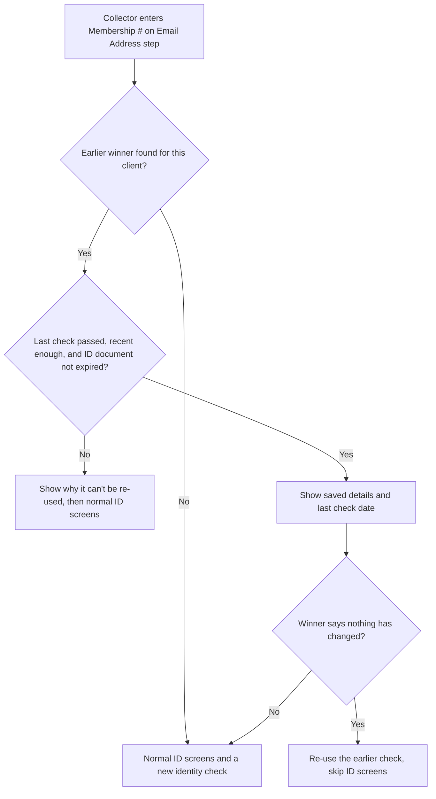

# Feature questions

Plans and open questions for features in progress. A feature's section is removed once the feature is marked complete.

---

## CRP-461 - Configurable Payout Source - Member Card / Promos

_Started: 2026-11-19 · Status: Ready for review (built with placeholder wording)_
Jira: [CRP-461](https://cruzmoney.atlassian.net/browse/CRP-461)

### What we're building

Venues pay out more than poker machine wins. A patron's member card balance (MyCash, Porters Perks) or a promotion prize can be paid to their bank account through Cruz. The Collector picks the payout type from four options: EGM, Member Card, Gaming Promotion and Club Promotion. The checks are the same for every type; only the label changes. The Approver, the Authoriser, both patron emails, the bank statement description and the payment file all show the type, because the venue's accounting system codes each payment by it. Each venue switches the non-EGM types on or off in Venue Settings.

### Words we're using

- **Payout Type:** the existing field on Create New Payout (it offered EGM, TAB and Keno). It is re-used to say where the payout came from. The ticket calls this "Payout Source"; the customer calls it "payout type".
- **EGM:** a win from a poker machine. This is how payouts work today.
- **Member Card:** a patron's member card balance (MyCash from Max Gaming, Porters Perks). It is a stored-value card, not a place to pay into, and it holds up to $10,000. The MyCash number is the member number. A venue can rename this option, for example to "MyCash" (question 3). MyCash is used by pubs and clubs in Queensland and the Northern Territory.
- **Gaming Promotion:** a prize from a gaming promotion, for example a member number drawn on a promotion night. It doesn't count towards gaming tax. _Name to confirm._
- **Club Promotion:** a prize from a member or club-wide promotion, run by the venue's marketing. _Name to confirm._
- **Bank statement description:** the text that shows on the bank statement line for the transfer. The venue's accounting system (Xero) reads it to code the payment. The wording follows Lee's list (question 4).
- **Venue toggle:** a per-venue on/off switch in Venue Settings, the same as the Manual Bank Transfer and Cheque switches.

### How we plan to build it

- **Who uses it:**
  - Admin, in Venue Settings: turns the types on or off.
  - Collector, on step 1 Create New Payout: picks the type.
  - Approver and Authoriser, on the review pages: see the type and the bank statement reference.
  - Patron: sees the type in the two emails (after collection, and when the money is transferred) and on the bank statement.
  - Authoriser: downloads the payment file, which shows the type.
- **Where:**
  - `/admin/venues/[id]`: a new "Payout Types" group under Payouts settings.
  - `/collector/payout-details`: the Payout Type field.
  - `/collector/summary`.
  - `/approver/payout` and `/authoriser/payout`: new scenarios in the prototype switcher.
  - `/authoriser/manual-bank-export`: the CSV gets the payout type and the bank statement description.
  - New email preview route (path to decide): the two patron emails, with the text that changes by type.
- **Reuse:**
  - In Venue Settings: `PaymentMethodRow` (switch cards), `AlwaysAvailableMethodRow` (EGM is always on), `Switch`, `FormField` and `TextInput`.
  - In the Collector flow: `SelectInput`.
  - On the review pages: `DetailList`, `ScenarioSwitcher`, and the `paymentMethods`-style label constants in `lib/venue-data.ts`.
- **New:**
  - `lib/payout-types.ts`: one list of the four types, with each type's label, code, bank statement description and email text. A `buildBankDescription()` helper builds the description. Every screen, the CSV and the emails read from this list, so wording changes in one place. The descriptions are placeholders until Lee's list arrives.
  - New fields on `Venue` in `lib/venue-data.ts`: `memberCardEnabled`, `gamingPromotionEnabled`, `clubPromotionEnabled`, and an optional `memberCardName`.
  - `components/admin/PayoutTypeSettings.tsx`: the group of payout type cards in Venue Settings. EGM is fixed On. Member Card, Gaming Promotion and Club Promotion each have a switch, and Member Card has an optional Display Name.
  - A Bank Statement Description row in Payout Details on the review pages. A plain `DetailList` row unless it needs more.
  - A Payout Type column and a Bank Statement Description column in the Manual Bank Transfer CSV (`lib/manual-export-data.ts`).
  - Email preview components (names to decide), one per email, with the type-specific line taken from `lib/payout-types.ts`.
  - Collector step 1 changes:
    - Venue moves above Payout Type, because the options depend on the venue.
    - Machine shows only for EGM.
    - TAB and Keno are removed.
    - The member number is already captured on every payout, so Member Card needs nothing extra.
  - `docs/design.md` gets the new components, fields and route.
- **Not changing:** the checks. ID, screening, bank account checks and the $5,000 rule are the same for every type.
- **Mock data and scenarios:**
  - Riverside RSL Club (Queensland) has all four types on, with Member Card renamed to "MyCash".
  - One other venue has only EGM, to show the field with a single option.
  - New review scenarios: `member-card`, `gaming-promotion` and `club-promotion`, next to the current EGM ones.
  - Example bank statement description: placeholder until Lee's list arrives.
- **Wording to confirm:**
  - "Gaming Promotion" and "Club Promotion".
  - "Member Card", and whether it is shown as "MyCash" for Queensland venues.
  - The bank statement description and email text for each type (from Lee's list).
  - "Bank Statement Description" as the row label.

### Questions

Answers below come from the call with Lee (head of finance at the customer) on 2026-11-19. Each question is marked **✅ Answered**, **🟡 Partly answered** or **🔴 Unresolved**.

1. **Should the screen label stay "Payout Type", or change to "Payout Source"?** "Payout Type" is already on the Collector screen, and venues know it. "Source" is closer to what it means, but it's a new word. Default: keep **Payout Type**.
   - ✅ **Answered:** Keep **Payout Type**. Lee uses the term himself ("the MyCash is the payout type"), and the team called it "the payout type drop-down" on the call.
2. **Should Member Card and Promo be two separate options, or one "Member Card / Promo" option?** Two options give the finance team two codes to filter on. One option is simpler, and was the working label in the meeting. Default: **two separate options** (EGM, Member Card, Promo).
   - ✅ **Answered:** Separate options, and there are **four types, not three**: **EGM**, **MyCash** (member card), **Gaming Promotion** and **Member / Club-wide Promotion**. Each goes to a different account code in the venue's accounting system:
     - EGM payouts count towards state gaming tax.
     - Gaming promotions don't count towards gaming tax.
     - MyCash goes to its own code.
     - Club-wide promotions go to the marketing division.
   - 🔴 **Still to confirm:** the exact names on screen ("Gaming Promotion", "Club Promotion" or Lee's own wording). Jackpot was also mentioned as a source of payouts ("or it'll be a jackpot"). Confirm whether it is just EGM or needs its own type.
3. **Can a venue rename the Member Card option (for example to "Porters Perks")?** The meeting asked for some control over the display name. Default: an **optional Display Name** for Member Card in Venue Settings. Collectors see that name, while the code in the bank reference stays fixed. Promo keeps its name.
   - 🟡 **Partly answered:** Not asked directly. The call confirms "MyCash" is Max Gaming's product name, so other venues and card systems will use other names (for example Porters Perks). That supports a venue display name. Whether venues need to rename it is still unconfirmed.
4. **What are the three-letter codes, and what is the reference format?** The meeting suggested payout number, then the code, then patron info. Default: codes **EGM / MEM / PRO**, format `<Payout ID> <Code> <Initial Surname>`, cut to 18 characters. Example: `764 MEM V MISHRA`.
   - 🔴 **Unresolved:** Lee will **email the list of descriptions they use now** for each payout type. The bank statement wording should match it as closely as possible, because their accounting system (Xero) reads the bank statement line to code each payment automatically. Wait for Lee's list before fixing the codes and format.
5. **Where should the bank statement reference appear in the prototype?** Default: as a **"Bank Statement Reference" row** in Payout Details on the Approver and Authoriser pages, and as a new column in the Manual Bank Transfer CSV. The CSV would then have 8 columns, which may also settle the open 7-or-8-columns question.
   - ✅ **Answered:** The payout type must show in two places:
     - **The bank statement description** of the transfer, so the patron and the venue see it.
     - **The CSV / payment file**, which must "identify them separately".

     The same wording should also match the two patron emails (see question 7).
6. **What extra details does the Collector enter for Member Card and Promo?** There is no machine for these, so Machine would be hidden. Default: **Member Card: nothing extra** (the membership number is already captured with the member details). **Promo: an optional "Promotion Name"** (for example "Friday Door Prize"). The docket stays for all types.
   - 🟡 **Partly answered:**
     - **MyCash:** no machine is needed ("you don't need to know the EGM anymore once it's transferred to the card"). The **MyCash number is the same as the member number**, and the member number is captured on every payout, so nothing extra is needed.
     - **Every type:** ID checks, screening and bank account checks still apply. The $5,000 rule is the same whatever the type ("5K is 5K"). Only the identifier changes, not the process.
     - 🔴 **Still to confirm:** whether promotions need any extra field (such as a promotion name), and whether the docket is still needed for MyCash and promotions.
7. **Should the prototype show emails?** No email screens exist yet. Default: **one static email preview page** (the "payout awaiting approval" email) with a Payout Type line, so the developer can see where it goes. If you know which emails are meant, list them.
   - ✅ **Answered:** There are **two patron emails**, and their text must match the payout type:
     - one sent at the end of collection
     - one sent when the money is transferred

     Together with the bank statement, that makes three places the patron sees, and the wording must be consistent across all three. The logic is "if MyCash, insert this text; if club promotion, insert that text". The emails are generic today.
   - 🔴 **Still to confirm:** the email text for each type. It will probably follow Lee's list from question 4.
8. **Should we build anything for the waiting period now?** The meeting left this open for Lee (head of finance at the customer). Default: **build nothing for it** and keep it as an open question. If needed later, it could be a per-venue "minimum wait before payment" setting.
   - 🟡 **Partly answered:** A 24 to 48 hour hold before payment came up, but for the **payment file** flow: the file should only include payouts that have passed their time frame. It was not described as a rule for MyCash or promotions. Nothing to build in this ticket.
9. **Should EGM always be on, or switchable like the others?** Default: **EGM is always on** (a fixed On switch, the same as Electronic Fund Transfer). Member Card and Promo are off until the venue turns them on.
   - 🟡 **Partly answered:** Not asked directly. The call says **MyCash exists only for pubs and clubs in Queensland and the Northern Territory**. The suggestion was to use the venue's postcode (starting with 4 for Queensland) to decide which types are offered, which fits the earlier idea of a state on the venue. EGM always on, and the per-venue switches for the other types, are still unconfirmed.
10. **Should the Admin Payouts Dashboard get a Payout Type column or filter?** Default: **not in this ticket**, so the scope stays on Collector, review pages, Venue Settings and reference.
    - 🔴 **Unresolved:** Not discussed on the call.
11. **(New, from the build) Should the payment file show the venue's own Member Card name (for example "MyCash") or the standard "Member Card"?** The screens show the venue's name. The CSV shows "Member Card" so the column is the same for every venue. Default: keep **"Member Card"** in the CSV.
    - 🔴 **Unresolved**

---

## CRP-186 - Re-using winner details

_Started: 2026-11-19 · Status: Ready for review (draft, built with the defaults)_
Jira: [CRP-186](https://cruzmoney.atlassian.net/browse/CRP-186) (Jira status: Blocked, waiting on CRP-216 Frankie Integration Review)

### Is it already in the prototype?

**No.** Today every payout makes the Collector type the winner's ID details again, and the identity check runs every time. The pieces that exist:

- The Email Address step (`/collector/email-address`) already asks for **Membership #**, but nothing is looked up with it.
- The Approver and Authoriser pages have an **Identity Verification (IDV) History** table, but it only shows the current payout's check.
- `docs/cruz-money-system-overview.md` describes a "90-Day Returning Winner Policy" (skip the check for a repeat winner at the same venue within 90 days, Confirmation of Payee still required). Nothing in the prototype does this, and it doesn't match the newer Jira spec (a window each client sets, up to about 12 months).

### What this feature is (plain explanation)

When a winner is paid through Cruz, the Collector types their ID details (licence, passport and so on), and Cruz pays FrankieOne to check them. If the same person wins again next week, all of that happens again: the same typing, the same wait and another FrankieOne charge.

This feature lets Cruz **recognise a winner it has already checked** and **re-use that earlier identity check**, instead of running a new one:

1. The Collector enters the winner's **membership number**, as they do today.
2. Cruz searches that client's earlier winners for the same membership number.
3. If it finds them, and their last identity check **passed** and is **recent enough** (inside the client's re-use period, for example 12 months), the Collector sees the saved details: name, date of birth, ID document and the date of the last check.
4. The Collector asks the winner whether anything has changed. If **nothing has changed**, the payout re-uses the earlier check and skips the ID screens, with no FrankieOne charge. If **something has changed**, or the old check was too old, failed or incomplete, the Collector goes through the normal ID screens.
5. Every lookup and every re-use or re-check decision is recorded, so it can be audited later.

**Why:** fewer FrankieOne charges, faster payouts for regulars, and less re-typing (which also means fewer typing mistakes).

**What does not change:** the bank account check (Confirmation of Payee) still runs on every payout. Approval rules don't change, and no records are shared between different clients.

### Two approaches in the Jira text

The ticket holds two ideas, and they need a decision (question 1):

- **A. Earlier idea (top of the ticket):** confirm it's really the same person by **sending the winner an email**. The winner clicks to approve, or reads a code back to the Collector. This idea also talks about re-using **personal, bank and ID** details.
- **B. Later spec ("Returning Player Recognition & IDV Reuse", with the technical plan):** look up by **membership number** within the client. The **Collector confirms** the details are unchanged, and no email is sent. It re-uses **only the identity check**, not the bank account check. This is the more detailed and more recent version.

### Details pulled from the ticket (relevant to the UI)

- Re-use only a check that **passed and is complete**. Don't re-use failed checks, checks still processing, manual bypasses (No ID / Manual KYC) or checks where the service was unavailable.
- The re-use period is **set per client, in days**, with a cap of about 12 months. If it isn't set, nothing is re-used.
- The Collector **sees the saved record before re-using it**, and must confirm it is unchanged.
- **Edge cases:**
  - The ID document's expiry date. A review comment says the current design "won't check ID expiry date".
  - Membership numbers written differently (spaces or punctuation).
  - Existing winners with no membership number stored yet.
  - Two records with the same membership number.
- **Still open in Jira:**
  - Can a failed PEP result that was manually accepted be re-used?
  - Does the re-use period start from the date FrankieOne ran the check, or from the date Cruz assessed it?
  - How are older winners without a membership number linked?
- **Engineering only, not on screen:** hashed matching, database fields, audit records and data migration.

### Simple flow

### Words we're using

- **Returning winner:** someone this client has paid through Cruz before. The ticket says "returning player" and "returning customer". The customer-facing word needs confirming (question 11).
- **Identity check (IDV):** the FrankieOne check of the winner's ID document, plus the PEP and sanctions screening.
- **Re-use period:** how long a passed identity check can be re-used, in days, set per client.
- **Membership number:** the venue's member number, already captured on the Email Address step. For MyCash it is the same number (CRP-461).
- **Saved record:** the winner's details from their last checked payout.

### How we plan to build it

- **Who uses it:**
  - **Collector:** on the new screen after the Email Address step.
  - **Approver and Authoriser:** see on the review pages that the identity check was re-used, and from when.
  - **Admin (or Super Admin):** sets the re-use period.
- **Where:**
  - New Collector screen between `/collector/email-address` and `/collector/primary-id`, for example `/collector/returning-winner`.
  - Review pages: `/approver/payout` and `/authoriser/payout`.
  - Re-use period setting: Venue Settings or a client-level page (question 6).
- **Reuse:**
  - `StepFormLayout` and `DetailList` for the saved details.
  - `VerificationPill` for the last check's result.
  - `WarningAlert` for reasons a record can't be re-used.
  - `IdvHistoryTable`, extended with a "Re-used from payout #… on …" row.
  - `PaymentMethodRow` / `FormField` / `TextInput` for the setting.
- **New (names to settle):**
  - `lib/returning-winner.ts`: mock earlier winners and a lookup that returns found and re-usable / found but too old / found but failed / found but ID expired / not found.
  - `components/collector/ReturningWinnerView.tsx`: the decision screen.
  - A small "identity check re-used" note for the review pages.
  - A re-use period field.
  - A prototype-only scenario switcher, so reviewers can see each lookup result.
  - `docs/design.md` updated.
- **Mock data and scenarios** (click through each):
  1. Found and re-usable.
  2. Found, but the last check is older than the re-use period.
  3. Found, but the ID document has expired.
  4. Found, but the last check failed or was a No ID / Manual KYC exception.
  5. Not found (first-time winner).
  6. No membership number entered.
  7. The winner says details changed.
- **Wording to confirm:** the screen title and button labels, "Returning Winner", "Re-use period" and the reason messages.

### Questions

1. **Which approach should the prototype show: A (email or code sent to the winner) or B (membership number lookup, Collector confirms)?** B is the newer, detailed spec, and engineering's plan follows it. A adds a confirmation step from the winner. Default: **B**, with no email or code.
   - Answer: Use the default (user, 2026-11-20).
2. **What is re-used: only the identity check, or the bank details too?** Spec B re-uses only the identity check and runs the bank account check every time. Idea A mentions personal, bank and ID. Default: **identity details and the identity check only.** Bank details are entered as today.
   - Answer: Use the default (user, 2026-11-20).
3. **What should the Collector see in the saved record?** It is personal information shown on the gaming floor. Default:
   - full name
   - date of birth
   - ID document type
   - document number, masked to the last 3 digits
   - document expiry date
   - suburb and state
   - last check date and result
   - Answer: Use the default (user, 2026-11-20).
4. **How does the Collector confirm "nothing has changed"?** Default: two buttons, **"Details Are the Same, Use These"** and **"Details Have Changed, Check Again"**, after the Collector asks the winner. No tick box.
   - Answer: Use the default (user, 2026-11-20).
5. **If the ID document has expired (or expires today), must the winner be checked again even inside the re-use period?** This is the edge case in the ticket. Default: **yes, a full check again.** The screen says the document has expired.
   - Answer: Use the default (user, 2026-11-20).
6. **Where is the re-use period set: per client (the spec) or per venue (the ticket summary)?** The prototype only has Venue Settings today; there is no client settings page. Default: **a "Re-use Identity Check For (days)" field on Venue Settings**, maximum 365. Blank means off. Say if it must be client-level instead.
   - Answer: Use the default (user, 2026-11-20).
7. **Which earlier results can be re-used?** Default: **only a clean pass.** Not a failed check, a manual bypass, No ID / Manual KYC, or "service unavailable". A failed PEP result that was manually accepted is treated as **not re-usable** until Compliance decides (it's open in Jira).
   - Answer: Use the default (user, 2026-11-20).
8. **Should the Approver and Authoriser see that the check was re-used?** Default: **yes.** The IDV History shows "Re-used from payout #<number>, checked <date>", and the Identity Verification section says the check was re-used.
   - Answer: Use the default (user, 2026-11-20).
9. **What happens when no membership number is entered, or two records share one?** Default:
   - **No number:** skip the lookup and use the normal ID screens.
   - **Duplicate:** treat it as not re-usable and use the normal ID screens. The Collector isn't shown the duplicate.
   - Answer: Use the default (user, 2026-11-20).
10. **Does the "90-Day Returning Winner Policy" in the system overview still apply?** Default: **no.** It is replaced by the per-client re-use period. The overview doc can be updated later if you want.
    - Answer: Use the default (user, 2026-11-20).
11. **What should it be called on screen?** Options: "Returning Winner", "Returning Member", "Previous Identity Check Found". Default: screen title **"Returning Winner"**, with a line such as "This member was identity checked on 12/08/2026."
    - Answer: Use the default (user, 2026-11-20).
12. **Should we wait for the Jira blockers?** The ticket is Blocked (CRP-216), and the technical plan says policy decisions come first (Phase 0). Default: **build the prototype now** with the defaults above, so it can help those decisions. Mark it as a draft.
    - Answer: Use the default (user, 2026-11-20).

---
